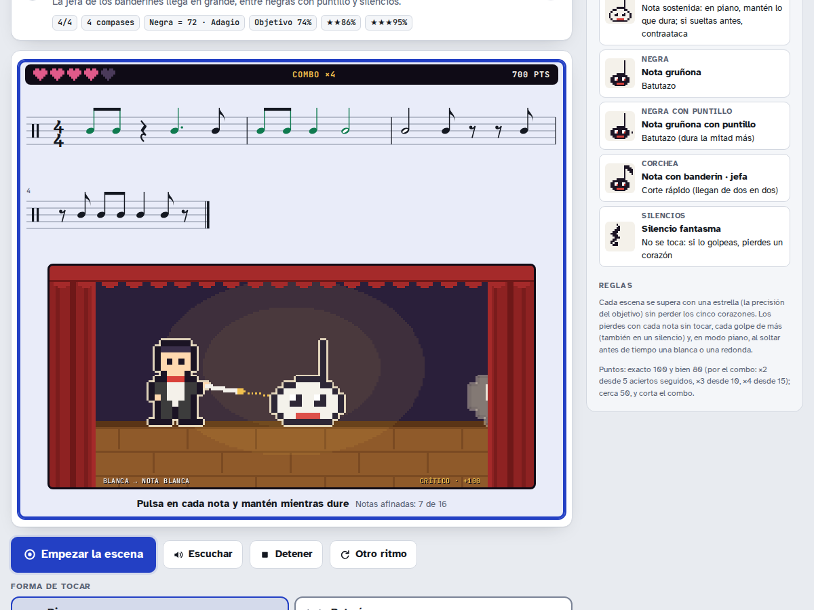
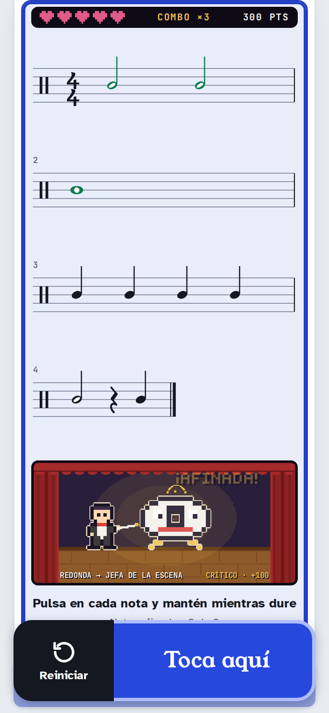
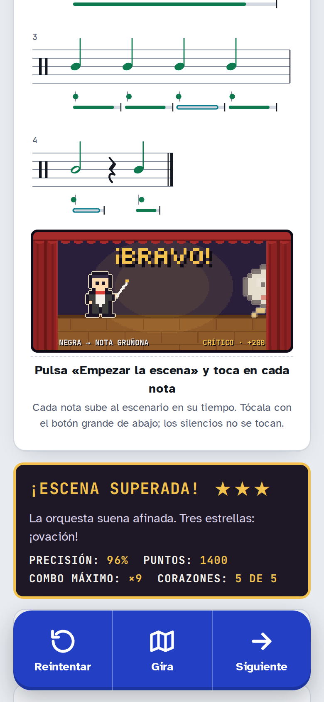
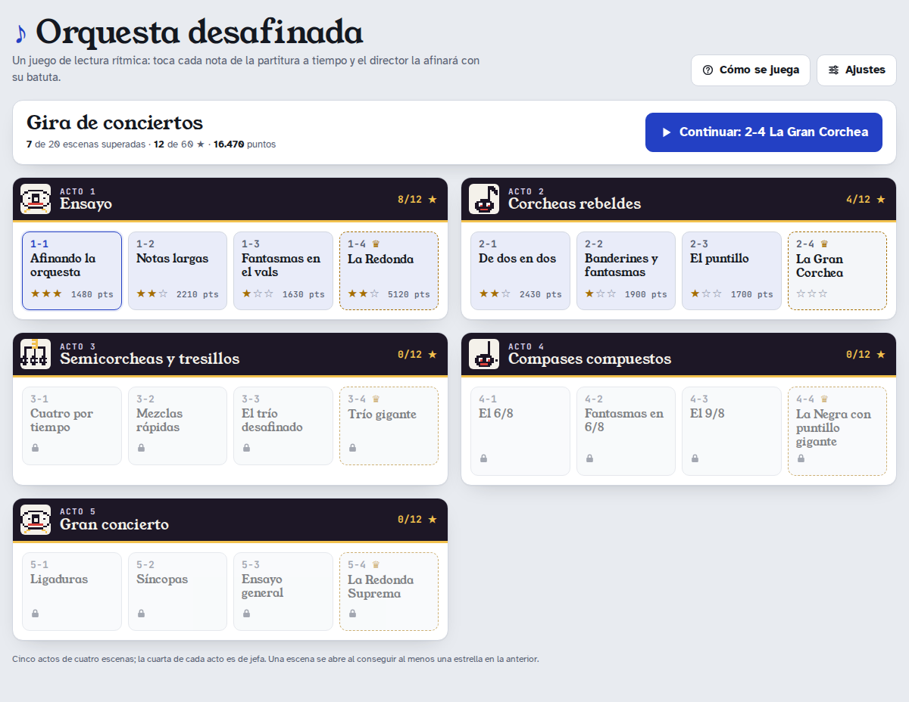

# Orquesta desafinada

Un juego web de lectura rítmica en pixel art. La orquesta se ha desafinado: cada nota de la partitura sube al escenario justo en su tiempo y, si la tocas a tiempo, el director la afina con su batuta. Corazones (según la dificultad), combos y puntos, en una gira de 20 escenas que va de las negras en el pulso a las síncopas, los tresillos y los compases compuestos.

Se juega con el dedo, el ratón o el teclado (la barra espaciadora), en el móvil o en el ordenador. Está en español.



## Cómo se juega

1. Elige una escena en el mapa de la **gira de conciertos**. Pulsa **Escuchar**: el director toca el ritmo de la partitura para que lo oigas.
2. Pulsa **Empezar la escena** (o toca la partitura). Tras un compás de cuenta, toca en cada nota: sobre la partitura o el escenario, con el botón grande de abajo en el móvil o con la barra espaciadora.
3. Cada nota sube al escenario en su tiempo. Si aciertas, el director la afina (cada figura tiene su golpe y su forma de caer: la negra, aplastada de un batutazo; la corchea, partida en dos de un tajo; la semicorchea, estallada por un rayo; el tresillo sale girando; la blanca y la redonda suben convertidas en notas) y sumas puntos: exacto 100, bien 80, por el **combo** (×2 desde 5 aciertos seguidos, ×3 desde 10, ×4 desde 15); cerca 50, y corta el combo.
4. Pierdes un **corazón** con cada nota sin tocar y cada golpe de más (también si golpeas un silencio: son fantasmas que cruzan el escenario). Sin corazones, cae el **telón**.
5. Al acabar, la **precisión** decide las estrellas: una con el objetivo de la escena (70–75 %), dos con 12 puntos más (máx. 90 %) y tres con 95 %. Basta con llegar al final con algún corazón para superar la escena y abrir la siguiente.

**Dificultad:** **Fácil** (8 corazones, el tempo al 80 % y los golpes de más no quitan corazón), **Normal** (5 corazones) o **Difícil** (3 corazones y el tempo un 15 % más rápido). Se elige en la escena o en *Ajustes*; las estrellas piden la misma precisión en las tres.

**Forma de tocar:** en **Piano** (la de por defecto) mantienes pulsada cada nota lo que dura y también se mide cuándo la sueltas; soltar antes de tiempo una blanca o una redonda hace que contraataque. En **Batería** solo cuenta el golpe, que suena como un redoblante. Se elige en la escena o en *Ajustes*.

Durante la escena, **Esc** (o *Detener*) la abandona sin resultados. En el móvil, el botón flotante tiene a la izquierda **Reiniciar** (mantener pulsado medio segundo) y, al terminar, se convierte en *Reintentar · Gira · Siguiente*.

 

## Escenas

| Acto | Escenas | Compás | Qué se aprende |
|---|---|---|---|
| 1. Ensayo | Afinando la orquesta · Notas largas · Fantasmas en el vals · **La Redonda** | 4/4, 3/4 | negra, blanca, blanca con puntillo, redonda y silencio de negra |
| 2. Corcheas rebeldes | De dos en dos · Banderines y fantasmas · El puntillo · **La Gran Corchea** | 2/4, 4/4 | corcheas, silencio de corchea, negra con puntillo |
| 3. Semicorcheas y tresillos | Cuatro por tiempo · Mezclas rápidas · El trío desafinado · **Trío gigante** | 2/4, 4/4 | semicorcheas y tresillos de corcheas |
| 4. Compases compuestos | El 6/8 · Fantasmas en 6/8 · El 9/8 · **La Negra con puntillo gigante** | 6/8, 9/8 | el pulso de negra con puntillo y sus silencios |
| 5. Gran concierto | Ligaduras · Síncopas · Ensayo general · **La Redonda Suprema** | 2/4, 3/4, 4/4 | ligaduras, síncopas y todo junto |

La cuarta escena de cada acto (en negrita) es de **jefa**: tiene más compases y su figura sale en grande. Cada vez que juegas, la partitura es nueva (generada al azar con las figuras de la escena, sin ocultar el pulso); *Otro ritmo* la cambia.



## Ajustes

En *Ajustes* (arriba a la derecha): forma de tocar, metrónomo durante la escena (la cuenta previa suena siempre), volumen del metrónomo y de *Escuchar*, oír tus propios toques, botón flotante y vibración en pantallas táctiles, **medir la latencia** de tu equipo (útil con auriculares Bluetooth: 4 clics de cuenta y tocas con los 16 siguientes) o ajustarla a mano, restablecer los ajustes y borrar el avance.

Tras cada escena, *Detalle de precisión* muestra tu porcentaje, el desvío bajo cada nota de la partitura (antes o tarde, y en piano cuánto la mantuviste), si aceleras o te retrasas, el error a tiempo, a contratiempo y tras un silencio, y un consejo concreto.

## Cómo abrirlo

No hay instalación ni compilación: abre `index.html` en el navegador. Necesita a su lado `styles.css` y las carpetas `js/` y `fonts/`. Funciona abriéndolo directamente (`file://`) o sirviendo la carpeta con cualquier servidor web, por ejemplo:

```sh
python3 -m http.server
```

El sonido empieza al pulsar un botón (los navegadores no dejan reproducir audio antes). Tus ajustes y tu avance se guardan solo en tu navegador (ver [`SECURITY.md`](SECURITY.md)).

### GitHub Pages

Al ser una página estática, basta con activar *Settings → Pages* con la rama `main` y la carpeta raíz (`/`). El juego no hace ninguna petición a otros sitios: las tipografías van en `fonts/` y la política de seguridad de contenidos (CSP) va en el propio `index.html`. Sus datos usan claves propias (`orquesta-desafinada-*`), así que no chocan con otras apps del mismo usuario de `github.io`.

## Accesibilidad

Se puede jugar entero con teclado (Tab, Intro, Espacio para tocar, Esc para abandonar) y con lector de pantalla: la partitura tiene un texto equivalente por sistema («Compás 1: negra, dos corcheas, negra, negra.»), los corazones, las estrellas y los cambios de la escena se anuncian, el foco no queda tapado por el botón flotante y los colores cumplen los contrastes de WCAG 2.2 AA en modo claro y oscuro (el escenario es siempre de noche). Las marcas de precisión se distinguen por la forma, no solo por el color. Con *reducir movimiento* no hay sacudidas, destellos ni partículas.

## Pruebas

Pruebas de navegador con Playwright y Chromium en `tests/*.test.js`:

```sh
npm install
npx playwright install chromium
npm test            # o: node tests/run.js [filtro]
```

- `juego.test.js`: mapa, cobertura de figuras de las 20 escenas, aciertos, combo, corazones (nota sin tocar, golpe de más en un silencio, blanca soltada antes en piano), telón, victoria y desbloqueo (también sin estrella), dificultad, Esc, *Escuchar*, recarga y validación del avance.
- `tiempo.test.js`: alineación de toques, evaluación a 240 ppm, piano, cuenta previa, hora del toque, volumen en vivo, planificador, metrónomo y latencia.
- `seguridad.test.js`: CSP, datos guardados maliciosos o corruptos, almacenamiento lleno y recorrido completo (también con `file://`) sin violaciones ni peticiones externas.
- `a11y.test.js`: contraste calculado desde `styles.css`, estructura, nombres accesibles, foco, diálogo de ajustes, *Reiniciar* con teclado, formas de los marcadores, movimiento reducido y colores forzados.
- `movil.test.js`: de 320 a 390 px y en horizontal, botón flotante, resultados encuadrados, 44 px y latencia.

En GitHub se ejecutan en cada *push* y *pull request* (`.github/workflows/tests.yml`).

## Créditos

Nace de la Aventura «Orquesta desafinada» de la app de solfeo [DandEtudeDuR](https://github.com/rpp396/DandEtudeDuR) (*Solfeo Rítmico*), de la que toma el motor de práctica: generación de ritmos según el pulso, partitura en SVG, audio, planificador, evaluación y latencia. Tipografías Young Serif, Atkinson Hyperlegible y JetBrains Mono, con licencia SIL Open Font License (`fonts/OFL-*.txt`).
